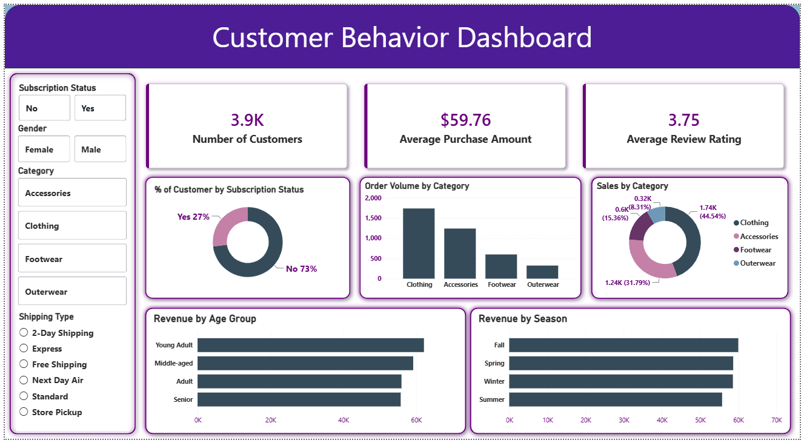

# 🛍️ Customer Shopping Behavior Analysis

An end-to-end data analytics project analyzing the shopping behavior of 3,900 retail customers to uncover revenue drivers, identify customer segments, and optimize product strategies.

This project covers the complete data lifecycle: **Python (Data Cleaning & EDA) ➔ MySQL (Advanced SQL Analysis) ➔ Power BI (Interactive Dashboard).**

---

## 🚀 Quick Links (For Recruiters)
*Explore the deliverables directly:*

*   📊 **[View the Interactive Power BI Dashboard](https://github.com/jerry-221/customer-shopping-behavior-analysis/blob/main/Customer_Behavior_Dashboard.pbix)** *(Download and open in Power BI Desktop)*
*   💻 **[View the 33 SQL Business Queries](https://github.com/jerry-221/customer-shopping-behavior-analysis/blob/main/queries.sql)**
*   📁 **[View SQL Query Results & Screenshots](https://github.com/jerry-221/customer-shopping-behavior-analysis/tree/main/Queries_screenshots)**
*   📓 **[View the Python Jupyter Notebook](https://github.com/jerry-221/customer-shopping-behavior-analysis/blob/main/Customer_Shopping_Behavior_code.ipynb)**
*   🖼️ **[View Dashboard Screenshot](https://github.com/jerry-221/customer-shopping-behavior-analysis/blob/main/Dashboard_Screenshot%202026-11-06%20131744.png)**

---

## 📖 Project Overview
A leading retail company wanted to better understand its customers to improve sales, satisfaction, and loyalty. Management needed to know which factors—such as discounts, reviews, seasons, or payment preferences—drive consumer decisions and repeat purchases. 

**Core Business Question:** *How can the company leverage customer shopping data to identify trends, improve engagement, and optimize marketing and product strategies?*

---

## 🗂️ Dataset
*   **Source:** `customer_shopping_behavior.csv`
*   **Size:** 3,900 rows and 18 initial columns.
*   **Attributes:** Customer demographics (Age, Gender, Location), purchase details (Item, Category, Amount), and behavioral metrics (Review Rating, Subscription Status, Payment Method, Purchase Frequency).

---

## 🛠️ Tools & Technologies
*   **Python (pandas, seaborn):** Data cleaning, handling missing values, and feature engineering.
*   **MySQL:** Relational database storage and advanced business querying.
*   **Power BI:** Interactive dashboard design, KPI tracking, and data visualization.

---

## ⚙️ Project Workflow

1.  **Data Cleaning & Feature Engineering (Python):**
    *   Imputed missing `Review Rating` values using category-level medians.
    *   Dropped redundant columns (verified `promo_code_used` was identical to `discount_applied`).
    *   Engineered 11 new features, including `loyalty_tier` (New/Returning/Loyal), `region`, and `customer_lifetime_value`.
2.  **SQL Analysis (MySQL):**
    *   Exported the cleaned dataset to a MySQL database.
    *   Wrote **33 queries** ranging from basic aggregations to advanced analytics using Window Functions (`ROW_NUMBER()`, `NTILE()`) and CTEs to extract deep insights.
3.  **Data Visualization (Power BI):**
    *   Connected Power BI directly to the database.
    *   Built an interactive executive dashboard featuring cross-filtering slicers, KPI cards, and demographic breakdowns.

---

## 🖥️ Dashboard Preview

---

## 💡 Key Business Insights

1.  **The Subscription Gap:** Non-subscribers generate roughly 4× the total revenue of subscribers and have a slightly higher average spend. The subscription program is currently attracting lower-value customers, indicating a need for a program revamp.
2.  **Discount Dependency:** Top-selling products like Sunglasses, Boots, and Hats rely on discounts for ~45% of their sales. These pose a margin risk as they struggle to sell at full price.
3.  **Demographic Revenue Drivers:** Male customers generate 52% of total revenue (on 68% of the customer base), but female customers have a notably higher average spend per order. 

---

## 📂 Repository Structure
*   `Customer_Shopping_Behavior_code.ipynb` — Python notebook for EDA, cleaning, and feature engineering.
*   `customer_shopping_behavior.csv` — Raw dataset.
*   `customer_shopping_behavior_clean.csv` — Final cleaned dataset used for SQL and Power BI.
*   `queries.sql` — All 33 SQL queries with business context comments.
*   `Queries_screenshots/` — Folder containing screenshots of key SQL query results.
*   `Customer_Behavior_Dashboard.pbix` — The actual Power BI file.
*   `Dashboard_Screenshot 2026-11-06 131744.png` — High-res image of the final dashboard.

---
*Created by Pranav Pail*
